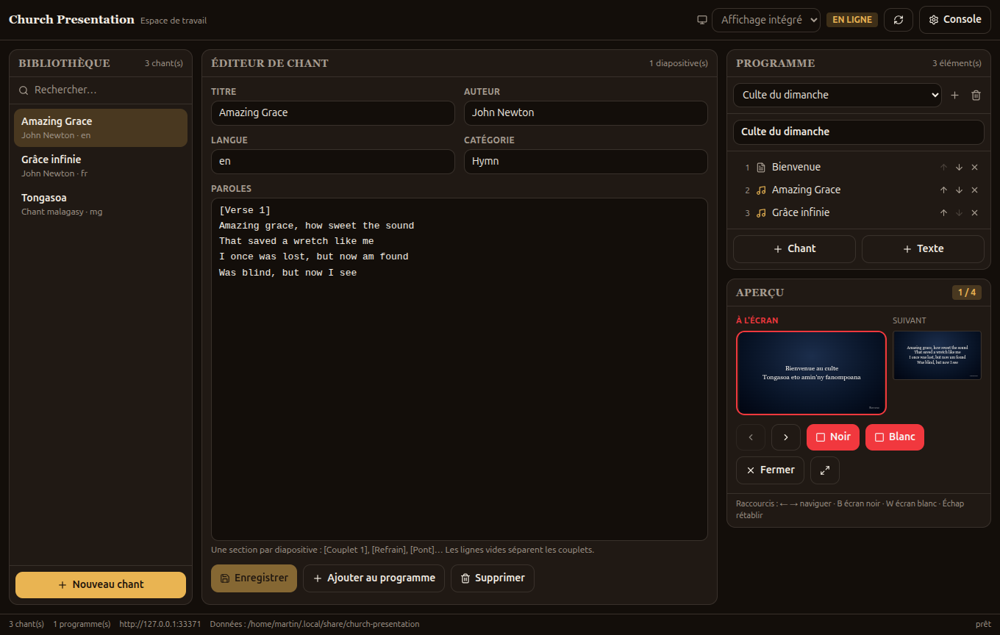
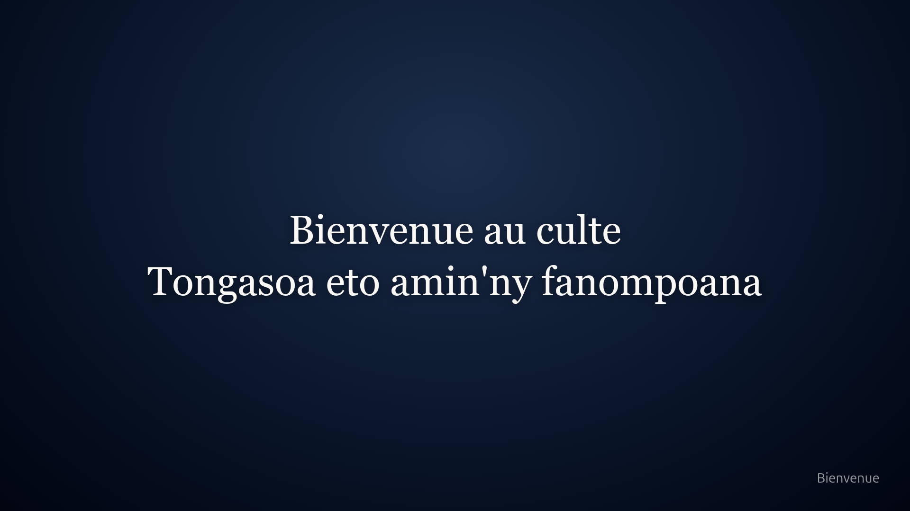
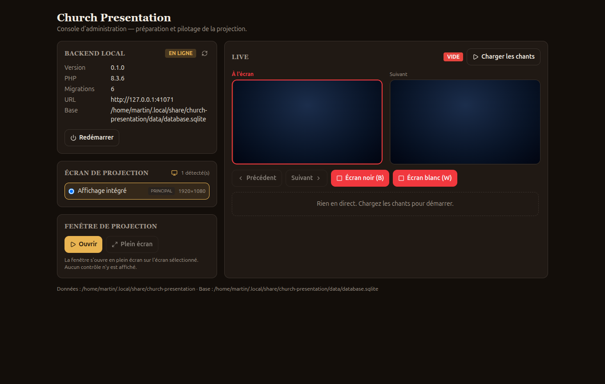
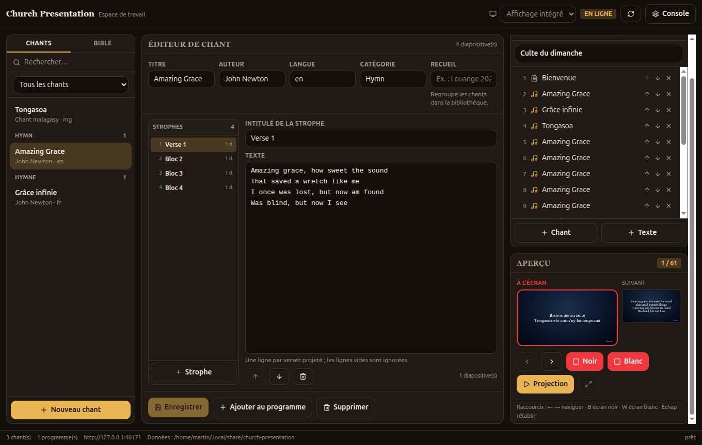
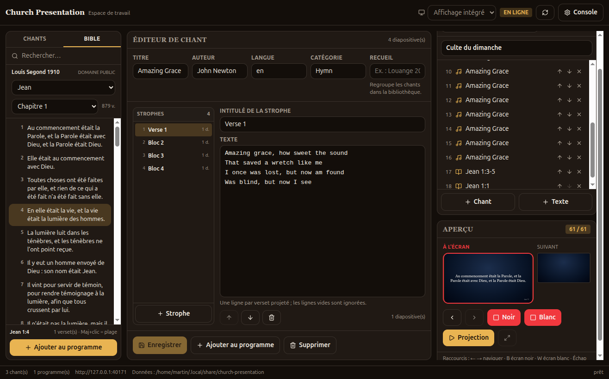

# apps/desktop — Espace de travail, console et fenêtre de projection

Application de bureau (Electron) de **Church Presentation** : une fenêtre
_espace de travail_ (bibliothèque de chants, éditeur, programme, aperçu — dans
l'esprit de VideoPsalm) pilote une fenêtre _projection_ indépendante ouverte en
plein écran sur l'écran sélectionné ; la _console_ d'administration (backend,
écrans, LIVE) est à un clic.

Voir [`PLAN.md`](../../PLAN.md) (phases 2, 3, 5 et 6) et
[`docs/phase-1-cadrage.md`](../../docs/phase-1-cadrage.md) (cadrage).

## Prérequis

- Node.js 20+
- PHP 8.3 avec l'extension `pdo_sqlite` :
  - sous Linux sans droits root → `tools/setup-php-ext.sh` (extrait le paquet
    Ubuntu dans `tools/php-ext/`), le wrapper `tools/php.sh` ajoute les flags ;
  - sous Windows → le runtime PHP embarqué (Phase 8) fournit déjà l'extension.
- `composer install` déjà fait dans `backend/` (créé via `composer create-project`).

## Commandes

```sh
cd apps/desktop
npm install

npm run dev        # Vite + Electron, rebuild automatique de main/preload
npm run build      # renderer statique + bundles Electron
npm run dist:win   # installeur Windows x64 (NSIS) dans release/
npm start          # lance Electron sur les bundles construits

npm run typecheck  # tsc --noEmit (renderer + electron + shared)
npm test           # vitest (contrat IPC)
```

`npm run dist:win` prépare un installeur Windows x64 autonome. Il télécharge le
runtime PHP 8.3 NTS officiel, prépare le backend Laravel et y inclut les données
Bible et chants configurées pour ce projet ainsi que les images du dossier
`Images with names`. Ces images sont copiées une seule fois dans la bibliothèque
Médias au premier démarrage, sans remplacer les fichiers déjà présents. Le
fichier généré est
`release/Church-Presentation-0.1.0-Setup.exe`. L’installeur utilise l’icône
`build/icon.ico` et installe le runtime Visual C++ requis par PHP si nécessaire.
Les données utilisateur sont conservées lors de la désinstallation.

Les paroles trop longues sont automatiquement réduites pour tenir dans la zone
de projection ; les mots trop longs sont également coupés si nécessaire.
L'espace de travail et la console proposent un mode clair/sombre, mémorisé avec
les réglages de l'application. Ce choix n'affecte pas l'écran de projection.

Le renderer peut aussi s'ouvrir dans un navigateur (`npm run dev`, sans
Electron) : l'UI dégrade proprement (pas de sélection d'écran, pas de fenêtre
de projection native) et parle à l'API locale via le proxy Vite `/api`.

## Architecture

```
apps/desktop/
├── shared/ipc.ts        contrats : canaux IPC, types échangés (source unique)
├── electron/
│   ├── main.ts          fenêtres, écrans, enregistrement des handlers IPC
│   ├── preload.ts       contextBridge → window.church (whitelist stricte)
│   └── backend.ts       démarrage/arrêt de Laravel, migrations, /api/health
├── src/
│   ├── api.ts           client REST typé (base URL = port éphémère du backend)
│   ├── hooks.ts         hooks partagés : backend, écrans, projection, chemins
│   ├── lyrics.ts        découpe des paroles en strophes / versets projetables
│   ├── program-slides.ts diapositives d'un élément de programme (y compris instantanés)
│   ├── components/ui.tsx atomes d'interface (carte, bouton, badge, champ)
│   ├── workspace/       espace de travail : onglets Programme/Chants/Bible à gauche,
│                        éditeur au centre, diapositives et aperçu à droite
│   └── pages/           console d'administration et fenêtre de projection
└── scripts/             build esbuild (main/preload) et runner de dev
```

Points clés :

- **Deux fenêtres, un build** : `index.html` est l'espace de travail (la console
  s'ouvre depuis le bouton _Console_), `index.html?window=projection` est l'écran
  public.
- **Espace de travail** : les chants et les programmes viennent de l'API Laravel
  (le `localStorage` de l'app web n'est pas lu) ; l'état LIVE, lui, reste dans le
  magasin partagé `src/lib/store.ts` et est poussé vers Electron en IPC.
  Chaque changement de programme est enregistré immédiatement (`PUT`).
- **Navigation simple, style VideoPsalm** : un seul panneau gauche avec les onglets
  **Programme**, **Chants**, **Bible** et **Médias** évite d'afficher agenda et bibliothèque
  en même temps. Les panneaux restent montés pour conserver recherches et sélections.
  Sélectionner un chant le charge dans l'éditeur et l'envoie automatiquement en LIVE.
  Les détails secondaires (auteur, langue, catégorie, recueil) restent repliés dans l'éditeur.
  Le programme peut être créé directement depuis son onglet ;

  choisir un élément du programme ou une diapositive le projette. Une référence Bible de plage,
  par exemple `Jaona 3:1-19`, sélectionne la même plage qu’un Maj+clic et la projette
  automatiquement. Les passages peuvent aussi être ajoutés au programme. Dans l'aperçu LIVE, `Ctrl+W` ou le
  bouton _Masquer paroles_ masque/affiche le texte du slide sans masquer sa référence.
  `F5` démarre le diaporama sur l’écran sélectionné ; sans choix enregistré, le deuxième écran est
  utilisé automatiquement (l’écran principal s’il n’y en a qu’un). Son bouton de lancement est affiché en icône seule.
- **Instantanés** : un élément `song` ou `verse` emporte un `snapshot` (titres, paroles,
  versets, référence, traduction) figé à l'ajout — un programme passé se projette même
  si le chant est ensuite modifié ou supprimé.
- **IPC typé** : `shared/ipc.ts` déclare les canaux ; `main.ts` enregistre un
  handler par canal via un type mappé (`Record<keyof typeof IPC, …>`) — un
  canal oublié casse la compilation, le preload n'expose que ces canaux.
- **Écrans** : `displays:list/select`, écoute `display-added/removed/metrics`.
  Sans écran cible choisi, la projection bascule automatiquement sur l’écran secondaire lorsqu'il est branché.
  Si l'écran cible disparaît, la fenêtre est garée sur l'écran principal en
  mode fenêtré et la console affiche « écran introuvable » + bouton
  _Réactiver la projection_.
- **Backend local** : `BackendManager` crée les répertoires de données, le
  `.env` de première exécution, lance `artisan migrate`, puis
  `php -S 127.0.0.1:<port> -t public public/index.php` et attend
  `/api/health`. Aucune connexion externe.
- **Données utilisateur** : `%LOCALAPPDATA%\ChurchPresentation` (Windows) ou
  `~/.local/share/church-presentation` (Linux) — jamais dans le répertoire
  d'installation. Surcharge possible avec `CHURCH_DATA_DIR`.

## Importer des chants

Dans l'onglet **Chants**, le bouton **Importer** accepte plusieurs fichiers `.txt`,
`.md`, `.json` et `.pptx` à la fois :

- `.txt` : titre sur la première ligne, paroles ensuite ;
- `.md` : titre sous forme de titre Markdown (`# Titre`), paroles ensuite ;
- `.json` : un objet `{ "title": "...", "lyrics": "..." }`, un tableau de ces
  objets, un objet `{ "songs": [...] }` ou l'ancien format Hira
  `{ "table_hira": [...] }` ;
- `.pptx` : un fichier crée un chant ; son nom devient le titre et le texte des
  diapositives, dans leur ordre de présentation, devient les paroles.

Chaque chant doit avoir un titre et des paroles. Les imports réussis sont ajoutés
à la bibliothèque sans remplacer les chants existants ; les erreurs sont
signalées fichier par fichier. Les autres formats ne sont pas interprétés.

## Variables d'environnement

| Variable               | Rôle                                                                      |
| ---------------------- | ------------------------------------------------------------------------- |
| `CHURCH_DATA_DIR`      | racine des données utilisateur (base, médias, sauvegardes, journaux)      |
| `CHURCH_PHP`           | chemin vers le binaire PHP à utiliser                                     |
| `CHURCH_BIBLE_FILE`    | chemin du JSON biblique à importer (sinon recherche automatique)          |
| `CHURCH_BIBLE_MG_FILE` | chemin de `Bible_MG65.json` (sinon recherche automatique)                 |
| `CHURCH_SONGS_FILE`    | chemin du recueil `addF_r6.json` à importer (sinon recherche automatique) |
| `VITE_DEV_SERVER_URL`  | positionne le renderer en mode dev (posé par `npm run dev`)               |

Au démarrage, l’application importe aussi `Bible_MG65.json` si le fichier et
son sidecar `Bible_MG65.meta.json` sont présents. Le format JSON exporté de
la base est converti en versets puis indexé pour la recherche. La Bible est
accessible dans l’onglet **Bible** via le sélecteur de traduction. La version
identifiée par le fichier est **Ny Baiboly Malagasy (1865)** ; voir
[`public/bible-mg1865.license.md`](../../public/bible-mg1865.license.md) pour
la provenance et l’autorisation déclarée. Pour un build empaqueté, placer les
deux fichiers JSON côte à côte dans `backend/database/seeders/` ou définir
`CHURCH_BIBLE_MG_FILE` vers le JSON (son sidecar doit rester à côté).
La traduction malgache est sélectionnée par défaut lorsqu’elle est importée ; sinon,
le panneau revient à la première traduction disponible. Le panneau Bible affiche
une seule traduction sélectionnable à la fois, avec
la recherche textuelle et la recherche par référence. Une plage reconnue est
sélectionnée et projetée automatiquement après la saisie. Un nom partiel ou une
faute d'une lettre dans un mot du titre du livre est accepté (ex. `Mation 3:5-9`
pour **Evanjelin’i Matio**). Les suggestions de livres apparaissent pendant la
saisie ; `Tab` accepte la première suggestion et complète le nom, par exemple
`Asa` → **Asan’ny Apostoly**. Les abréviations servent aussi dans les références
avec chapitre et versets.

Au démarrage, l'application importe le recueil `addF_r6.json` trouvé dans
`backend/database/seeders/` ou à la racine du dépôt. Les 543 chants sont
ajoutés à la bibliothèque sans remplacer les chants déjà présents. Le champ
`namelist` devient la catégorie, et les paroles HTML sont converties en texte.
Pour l'empaquetage, placer le fichier dans `backend/database/seeders/` ou
définir `CHURCH_SONGS_FILE`.

## Preuves d'exécution (Phases 2, 3 et 5)

Réalisées le 2026-11-02 sur Linux (session Wayland, un écran 1920×1080) :

| Vérification                                           | Résultat                                                                |
| ------------------------------------------------------ | ----------------------------------------------------------------------- |
| `tsc --noEmit` (renderer + electron + shared)          | OK                                                                      |
| `npm test` (vitest, contrat IPC)                       | 3 tests OK                                                              |
| `npm run build` (renderer statique + bundles CJS)      | OK                                                                      |
| `cd backend && ../tools/php.sh vendor/bin/phpunit`     | 22 tests, 74 assertions OK                                              |
| `curl /api/health` sur le serveur lancé par Electron   | `status: ok`, FTS5 `true`, 6 migrations                                 |
| Écrans détectés via IPC                                | `[{ id: 3, label: "Affichage intégré", 1920×1080, primary, selected }]` |
| Ouverture de la fenêtre de projection (pilotée en CDP) | 1 cible → 2 cibles (console + `index.html?window=projection`)           |
| État poussé par la console                             | le texte du diapositive s'affiche sur la fenêtre de projection          |
| Chemins utilisateur retournés par `getPaths()`         | `~/.local/share/church-presentation/{data,media,backups,logs,settings}` |
| Création de chants et d'un programme via l'API (CDP)   | 3 chants + 1 programme (3 éléments) en base SQLite                      |
| Espace de travail après rechargement (CDP)             | bibliothèque (3), éditeur, programme (3 éléments), aperçu `1 / 4`       |
| Ouverture seule de la projection                       | l'écran public affiche le **premier élément du programme**              |
| Navigation depuis l'espace de travail                  | compteur `1 / 4` → `2 / 4`, l'écran public suit                         |
| `DELETE /api/songs/{song}`                             | `204` si inutilisé, `409` + compteur si le chant est dans un programme  |

Espace de travail (bibliothèque | éditeur | programme + aperçu) :



La fenêtre de projection, ouverte depuis l'espace de travail, affiche le
premier élément du programme :



Console (backend en ligne, écran sélectionné, LIVE prêt) :



Fenêtre de projection après un `setProjectionState(...)` venu de la console :


## Preuves d'exécution (Phase 6 — Bible et programmes)

Réalisées le 2026-11-03 sur Linux (pilotage CDP, port 9228) :

| Vérification                                        | Résultat                                                                 |
| --------------------------------------------------- | ------------------------------------------------------------------------ |
| `tsc --noEmit`, `eslint apps/desktop`, `prettier`   | OK                                                                       |
| vitest `apps/desktop` (lyrics, program-slides, IPC) | 14 tests OK — vitest racine : 6 tests OK                                 |
| PHPUnit `backend/`                                  | 39 tests, 167 assertions OK                                              |
| Import Bible réel (`bible:import`)                  | 66 livres, 31 170 versets en 0,8 s, FTS5 vérifié (« grace » → « grâce ») |
| Onglet **Bible** (CDP)                              | 66 livres, chapitre + versets + mention « domaine public » affichés      |
| Recherche plein texte                               | « amour de dieu » → 25 résultats                                         |
| Sélection de passage                                | `Jean 1:3` (clic) puis plage `Jean 1:3-5` (`Maj+clic`)                   |
| Ajout au programme + instantané relu via l'API      | `versets: 3`, `traduction: Louis Segond 1910`                            |
| Aperçu / projection                                 | aperçu `1 / 64` avec la référence, fenêtre de projection affichée        |
| Éditeur de chant (style VideoPsalm)                 | barre d'édition (Titre, Auteur, Langue, Catégorie, Recueil) + 2 strophes |
| Dupliquer / archiver / restaurer                    | programme copié, archivé (disparaît des actifs), restauré                |

Éditeur avec barre d'édition et paroles séparées en strophes :



Onglet Bible (passage sélectionnable, licence affichée) :



Projection d'un passage du programme (instantané `Jean 1:1`) :


Captures recréables avec :

```sh
CHURCH_SCREENSHOT=/tmp/console.png npm start          # dump de la fenêtre console
node --experimental-websocket /tmp/cdp-verify.mjs 9222  # pilotage CDP (DevTools)
node --experimental-websocket /tmp/cdp-workspace.mjs 9222  # espace de travail + projection
```

Restent à valider sur une **VM Windows** (décision D5) : détection de plusieurs
écrans réels, plein écran sur écran secondaire, chemin `%LOCALAPPDATA%`.

## État

Phases 2 (fenêtres et multi-écrans), 3 (socle technique, SQLite, démarrage
contrôlé), 5 (espace de travail en panneaux) et 6 (Bible + programmes,
navigation style VideoPsalm) livrées. La phase 4 (authentification) a été
**retirée du périmètre** : pas de compte, pas de rôle. Restent : thèmes et
médias (7), sauvegarde et packageur Windows (8).
